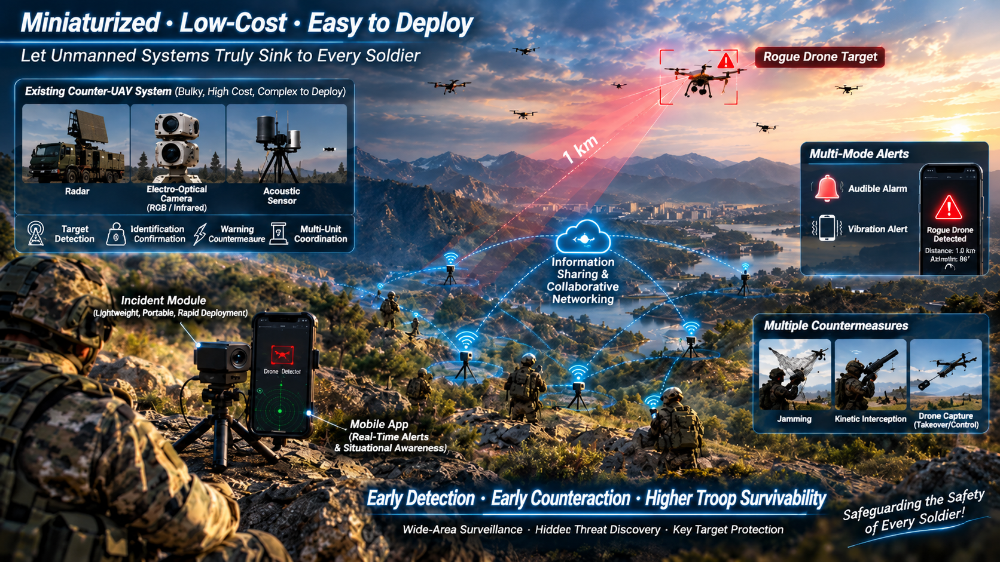

# Evkphone-UAV
Asynchronous UAV Detection and Tracking with Event Cameras on mobile phone

  

---
The mobile phone software follows [EVKphone]([code](https://github.com/Jia-Bao/EVKphone)).
----
The asynchronous annotation methodology follows [ASUMOT](https://arxiv.org/abs/2607.11303) ([code](https://github.com/Jia-Bao/ASUMOT)).
