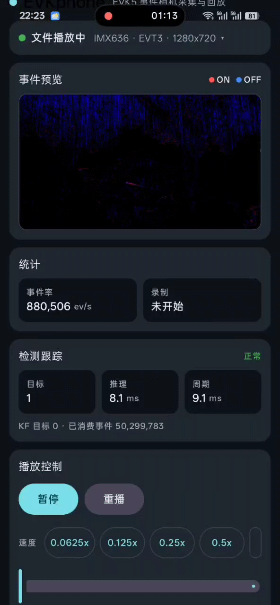

# Evkphone-UAV

## Asynchronous UAV Detection and Tracking with Event Cameras on mobile phone

  

### The asynchronous sensing advantages of event cameras provide effective modality information for counter-UAV missions. Although counter-UAV algorithms based on event cameras are constantly emerging, they are limited by end-side computational capabilities and the special asynchronous processing methods, resulting in few counter-UAV detection devices that can be directly applied to mobile terminals. To achieve the "last mile" of counter-UAV operations and enhance the flexibility and portability of UAV detection, we have developed this UAV detection software that can directly connect to event cameras.

  

## Cite
The mobile phone software follows [EVKphone] ([code](https://github.com/Jia-Bao/EVKphone)).

The asynchronous annotation methodology follows [ASUMOT](https://arxiv.org/abs/2607.11303) ([code](https://github.com/Jia-Bao/ASUMOT)).
